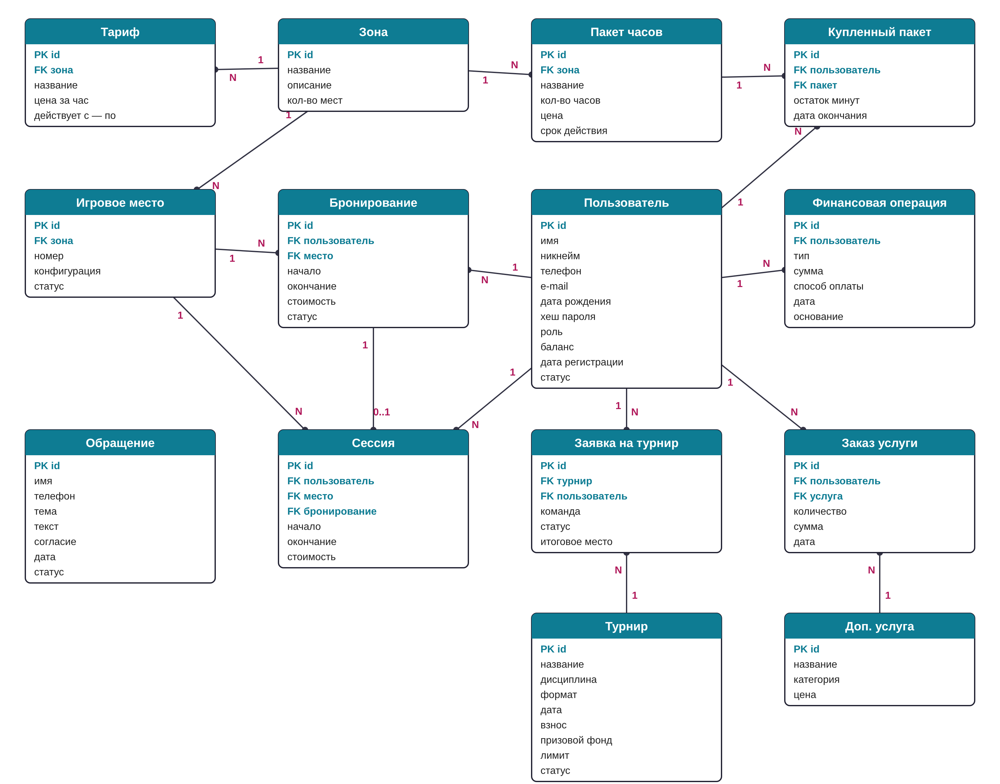

# Общие сведения

## Полное наименование системы и её условное обозначение

Полное наименование: информационная система управления компьютерным клубом «TurboPC».

Краткое наименование: ИС «TurboPC» (далее — Система, ИС).

## Шифр темы

ИС-КК-2026.

## Наименование организаций — заказчика и разработчика

Заказчик: условная организация ООО «ТурбоПК» — компьютерный клуб (типовой объект автоматизации, описанный в разделе 3).

Разработчик: студент [ФИО], группа [ГРУППА].

## Основания для разработки

Основанием для разработки является задание на лабораторную работу по дисциплине, посвящённой проектированию информационных систем (тема «Компьютерный клуб»).

## Плановые сроки начала и окончания работ

Начало работ: сентябрь 2026 г. Окончание работ: декабрь 2026 г.

## Источники и порядок финансирования

Работа выполняется в учебных целях, финансирование не предусмотрено.

## Порядок оформления и предъявления результатов работ

Результаты работ предъявляются заказчику поэтапно (см. раздел 5) в виде комплекта документов и прототипа интерфейса. Приёмка проводится в соответствии с разделом 7 настоящего ТЗ.

## Нормативные документы

При разработке используются:

- ГОСТ 34.602-2020 «Информационные технологии. Комплекс стандартов на автоматизированные системы. Техническое задание на создание автоматизированной системы»;
- ГОСТ 34.601-90 «Автоматизированные системы. Стадии создания»;
- ГОСТ Р 59795-2021 «Автоматизированные системы. Требования к содержанию документов»;
- ГОСТ 19.201-78 «Техническое задание. Требования к содержанию и оформлению»;
- Федеральный закон от 27.07.2006 № 152-ФЗ «О персональных данных»;
- Федеральный закон от 22.05.2003 № 54-ФЗ «О применении контрольно-кассовой техники».

## Определения и сокращения

| Термин | Определение |
|--------|------------------------|
| ИС | Информационная система |
| ПК | Персональный компьютер, игровое место клуба |
| Игровое место | ПК с периферией, закреплённый за зоной клуба |
| Зона | Группа игровых мест с единым уровнем оборудования и тарифом (Standard, VIP, Bootcamp) |
| Тариф | Стоимость одного часа игры в зоне |
| Пакет часов | Предоплаченный набор часов по фиксированной цене |
| Бронирование | Резервирование игрового места на дату и интервал времени |
| Сессия | Период фактического использования игрового места клиентом |
| Баланс | Внутренний денежный счёт клиента в Системе |
| Турнир | Соревнование между участниками или командами, проводимое в клубе |
| СУБД | Система управления базами данных |
| API | Программный интерфейс приложения |

# Назначение и цели создания системы

## Вид автоматизируемой деятельности

Система автоматизирует деятельность компьютерного клуба: предоставление игровых мест в почасовую аренду, бронирование, учёт игровых сессий, расчёты с клиентами, продажу дополнительных услуг, организацию турниров и информирование клиентов.

## Назначение системы

ИС «TurboPC» является веб-ориентированной информационной системой класса «система управления предприятием сферы услуг». Она предназначена:

- для клиентов — регистрации, просмотра схемы зала, бронирования игровых мест, оплаты, пополнения баланса, записи на турниры;
- для администратора клуба — управления залом, бронированиями, сессиями, оплатами и обращениями клиентов;
- для руководителя клуба — управления тарифами и турнирами, получения отчётности о загрузке и выручке.

## Цели создания системы

1. Сократить время оформления клиента на стойке администратора с 3–5 минут до 1 минуты за счёт онлайн-бронирования и предоплаты.
2. Исключить двойное бронирование одного игрового места на пересекающиеся интервалы времени.
3. Повысить загрузку зала за счёт отображения свободных мест в реальном времени и продажи пакетов часов.
4. Обеспечить прозрачный учёт денежных средств: каждое списание и пополнение баланса фиксируется в журнале операций.
5. Упростить проведение турниров: приём заявок, формирование сетки, публикация результатов.
6. Предоставить руководителю оперативную отчётность о выручке и загрузке по зонам.

## Задачи, решаемые системой

- ведение учётных записей клиентов и сотрудников с разграничением прав по ролям;
- отображение схемы зала со статусом каждого ПК (свободен, занят, забронирован, на обслуживании);
- бронирование игрового места на выбранные дату и время с контролем пересечений;
- ведение справочников зон, тарифов, пакетов часов и дополнительных услуг;
- открытие, продление и закрытие игровых сессий с автоматическим расчётом стоимости;
- ведение баланса клиента, пополнение и списание средств, история платежей;
- создание турниров, приём заявок участников, публикация результатов;
- приём обращений клиентов через форму обратной связи;
- формирование отчётов по выручке, загрузке и популярности тарифов.

## Используемые данные

Система обрабатывает следующие группы данных:

- персональные данные клиентов: имя, никнейм, телефон, адрес электронной почты, дата рождения (для проверки возрастных ограничений);
- данные сотрудников: ФИО, должность, роль в Системе;
- справочные данные: зоны, игровые места и их конфигурация, тарифы, пакеты часов, дополнительные услуги;
- операционные данные: бронирования, сессии, заказы услуг, финансовые операции;
- данные турниров: дисциплины, даты, призовой фонд, заявки, результаты;
- обращения клиентов.

## Концептуальные требования к системе

1. **Клиентоориентированность.** Основные сценарии клиента («забронировать ПК», «пополнить баланс», «записаться на турнир») выполняются не более чем за 3–4 шага.
2. **Реальное время.** Статус игровых мест на схеме зала обновляется без перезагрузки страницы с задержкой не более 5 секунд.
3. **Единая точка учёта.** Все денежные операции проходят через баланс клиента и журнал операций.
4. **Ролевая модель.** Каждая роль видит только необходимые ей функции и данные.
5. **Доступность с любого устройства.** Клиентская часть работает в браузере на ПК и мобильных устройствах.
6. **Масштабируемость.** Возможность подключения второго и последующих филиалов без переработки структуры данных.

# Характеристика объекта автоматизации

## Краткие сведения об объекте автоматизации

Объект автоматизации — типовой компьютерный клуб (киберклуб) площадью 250–350 м², работающий круглосуточно. Клуб оказывает услуги почасовой аренды игровых мест, продаёт напитки и снеки, проводит любительские турниры.

Структура игрового зала:

| Зона | Количество мест | Характеристика |
|----------------|--------|----------------------------------------|
| Standard | 20 | Общий зал, мониторы 24″ 165 Гц, стандартная периферия |
| VIP | 10 | Отдельный зал, мониторы 27″ 240 Гц, игровые кресла премиум-класса |
| Bootcamp | 5 (одна комната) | Изолированная комната для команды из 5 человек |

Организационная структура:

| Должность | Численность | Роль в Системе |
|------------------------|--------|----------------|
| Руководитель (управляющий) клуба | 1 | Руководитель |
| Администратор смены | 4 (посменно) | Администратор |
| Технический специалист | 1 | Администратор (с правами обслуживания ПК) |

Целевая аудитория клуба — геймеры в возрасте 14–30 лет, компании друзей, участники турниров. Ожидаемая посещаемость — 80–150 клиентов в сутки.

## Сведения об условиях эксплуатации

- круглосуточный режим работы клуба;
- рабочее место администратора — ПК на стойке ресепшена с доступом к сети Интернет;
- игровые ПК объединены в локальную сеть клуба;
- клиенты пользуются Системой с личных устройств (смартфон, ПК).

## Описание автоматизируемых бизнес-процессов

### БП-1. Регистрация клиента

Текущее состояние: администратор вручную вносит клиента в таблицу, данные дублируются, возраст проверяется устно.

Целевое состояние: клиент регистрируется на сайте сам (имя, никнейм, телефон, e-mail, дата рождения, пароль, согласие на обработку данных). Учётная запись становится доступной сразу после регистрации.

### БП-2. Бронирование игрового места

Текущее состояние: бронирование по телефону, фиксация в бумажном журнале, возможны двойные брони.

Целевое состояние:

1. Клиент открывает схему зала и выбирает зону.
2. Указывает дату, время начала и продолжительность.
3. Система показывает свободные на этот интервал места.
4. Клиент выбирает место, Система рассчитывает стоимость по тарифу.
5. Клиент подтверждает бронь; сумма блокируется (холдируется) на балансе.
6. Бронь удерживается 15 минут после времени начала; при неявке бронь аннулируется, удерживается штраф 50 % от стоимости первого часа.

### БП-3. Игровая сессия

1. Клиент приходит в клуб; администратор (или сам клиент по QR-коду) активирует бронь — открывается сессия.
2. Во время сессии стоимость списывается с баланса поминутно по тарифу или из пакета часов.
3. Клиент может продлить сессию, если место не забронировано на следующий интервал.
4. При завершении сессия закрывается, формируется запись в истории.

### БП-4. Пополнение баланса и оплата

1. Клиент выбирает сумму пополнения в личном кабинете или на стойке.
2. Оплата банковской картой, через систему быстрых платежей или наличными у администратора.
3. Система зачисляет средства и фиксирует операцию; формируется электронный чек.

### БП-5. Продажа пакета часов и дополнительных услуг

Клиент покупает пакет часов (3 часа, 5 часов, «Ночь») в каталоге с оплатой из баланса. Дополнительные услуги (напитки, снеки, аренда периферии) заказываются в личном кабинете или у администратора.

### БП-6. Организация турнира

1. Руководитель создаёт турнир: дисциплина, формат, дата, взнос, призовой фонд, лимит участников.
2. Клиенты подают заявки (индивидуально или командой), взнос списывается с баланса.
3. Администратор подтверждает участников, формирует сетку.
4. После турнира публикуются результаты, призы зачисляются на баланс победителей.

### БП-7. Обработка обращений

Клиент заполняет форму обратной связи (имя, телефон, тема, сообщение, согласие на обработку персональных данных). Администратор получает обращение, отвечает клиенту и меняет статус обращения.

### БП-8. Формирование отчётности

Руководитель получает отчёты: выручка за период по зонам и видам услуг, загрузка зала по часам, популярность тарифов и пакетов, активность клиентов.

# Требования к системе

## Требования к системе в целом

### Требования к структуре и функционированию системы

Система строится по трёхуровневой клиент-серверной архитектуре:

1. Уровень представления — веб-клиент (сайт клуба и личные кабинеты) и рабочее место администратора.
2. Уровень бизнес-логики — сервер приложений с REST API.
3. Уровень данных — реляционная СУБД.

Перечень функциональных подсистем:

| № | Подсистема | Обозначение |
|--------|----------------------------------------------------------------|------------------------|
| 1 | Подсистема учётных записей и авторизации | ПС «Аккаунт» |
| 2 | Подсистема управления залом и бронированием | ПС «Зал» |
| 3 | Подсистема тарификации и игровых сессий | ПС «Сессии» |
| 4 | Подсистема финансового учёта (баланс и платежи) | ПС «Финансы» |
| 5 | Подсистема турниров | ПС «Турниры» |
| 6 | Подсистема информационного портала и обратной связи | ПС «Портал» |
| 7 | Подсистема отчётности | ПС «Отчёты» |
| 8 | Подсистема администрирования | ПС «Админ» |

Подсистемы взаимодействуют через общую базу данных и внутренний API. Внешние интерфейсы: платёжный шлюз (эквайринг, СБП), SMS-шлюз, сервис электронной почты, онлайн-касса.

### Требования к численности и квалификации персонала

- Администратор — уверенный пользователь ПК, обучение работе с Системой не более 2 часов.
- Руководитель — уверенный пользователь ПК.
- Сопровождение Системы — специалист с навыками администрирования Linux-серверов и СУБД (может привлекаться по договору).

### Показатели назначения

- одновременная работа не менее 300 пользователей;
- количество игровых мест — до 200 (с учётом филиалов);
- время отклика интерфейса на типовые операции — не более 2 секунд;
- обновление статуса мест на схеме зала — не более 5 секунд.

### Требования к надёжности

- доступность Системы — не менее 99 % времени в месяц;
- резервное копирование базы данных — ежедневно, хранение копий не менее 30 дней;
- восстановление после сбоя — не более 4 часов;
- при потере связи с сервером открытые сессии не прерываются, данные синхронизируются после восстановления связи.

### Требования к безопасности и защите информации

- обработка персональных данных в соответствии с 152-ФЗ, получение согласия при регистрации и при отправке обращения;
- хранение паролей только в виде хеша (алгоритм bcrypt или Argon2);
- передача данных только по протоколу HTTPS (TLS 1.2 и выше);
- блокировка учётной записи на 15 минут после 5 неудачных попыток входа;
- разграничение доступа по ролям; журналирование действий администраторов;
- платёжные данные карт не хранятся в Системе, оплата проводится на стороне платёжного шлюза.

### Требования к эргономике и технической эстетике

- единый визуальный стиль (тёмная тема с яркими акцентами), соответствующий фирменному стилю клуба;
- контрастность текста не ниже уровня AA по WCAG 2.1;
- адаптивная вёрстка для ширины экрана от 360 до 1920 пикселей;
- интерфейс на русском языке.

### Требования к патентной чистоте

В Системе не используются чужие товарные знаки, логотипы и персонажи. Используемое программное обеспечение распространяется по свободным лицензиям или приобретается легально.

### Требования к стандартизации и унификации

Документация оформляется по ГОСТ 34.602-2020 и ГОСТ Р 59795-2021. Интерфейс строится на единой дизайн-системе (палитра, типографика, компоненты).

## Требования к функциям (задачам), выполняемым системой

### ПС «Аккаунт»

Назначение: регистрация, аутентификация пользователей и управление профилем.

| Код | Функция | Роль |
|--------|------------------------------------------------|----------------|
| А-1 | Регистрация клиента с проверкой корректности полей и уникальности телефона и e-mail | Гость |
| А-2 | Вход по телефону или e-mail и паролю | Все |
| А-3 | Восстановление пароля по коду из SMS или e-mail | Все |
| А-4 | Просмотр и редактирование профиля (имя, никнейм, контакты, пароль, уведомления) | Клиент |
| А-5 | Выход из Системы | Все |

### ПС «Зал»

Назначение: отображение схемы зала и бронирование игровых мест.

| Код | Функция | Роль |
|--------|------------------------------------------------|----------------|
| З-1 | Отображение схемы зала со статусами мест: свободно, занято, забронировано, на обслуживании | Все |
| З-2 | Фильтрация мест по зоне, дате и времени | Клиент, Администратор |
| З-3 | Создание брони с расчётом стоимости и контролем пересечений | Клиент, Администратор |
| З-4 | Отмена брони клиентом не позднее чем за 1 час до начала без штрафа | Клиент |
| З-5 | Просмотр активных броней | Клиент, Администратор |
| З-6 | Перевод места в статус «на обслуживании» | Администратор |

### ПС «Сессии»

Назначение: тарификация и учёт времени игры.

| Код | Функция | Роль |
|--------|------------------------------------------------|----------------|
| С-1 | Открытие сессии по брони или без брони | Администратор, Клиент (по QR-коду) |
| С-2 | Поминутное списание по тарифу или из пакета часов | Система |
| С-3 | Продление сессии при отсутствии конфликтующих броней | Клиент, Администратор |
| С-4 | Закрытие сессии и формирование записи истории | Администратор, Система |
| С-5 | Уведомление клиента за 10 минут до окончания оплаченного времени | Система |

### ПС «Финансы»

Назначение: учёт денежных средств клиентов.

| Код | Функция | Роль |
|--------|------------------------------------------------|----------------|
| Ф-1 | Пополнение баланса онлайн (карта, СБП) и на стойке (наличные, карта) | Клиент, Администратор |
| Ф-2 | Покупка пакета часов и дополнительных услуг с баланса | Клиент |
| Ф-3 | Холдирование суммы при бронировании и её списание или возврат | Система |
| Ф-4 | Просмотр истории платежей и операций | Клиент, Администратор |
| Ф-5 | Формирование электронного чека | Система |

### ПС «Турниры»

Назначение: проведение турниров клуба.

| Код | Функция | Роль |
|--------|------------------------------------------------|----------------|
| Т-1 | Создание и редактирование турнира | Руководитель |
| Т-2 | Просмотр списка ближайших турниров | Все |
| Т-3 | Подача заявки (соло или командой) с оплатой взноса | Клиент |
| Т-4 | Подтверждение участников, формирование сетки | Администратор |
| Т-5 | Публикация результатов и начисление призов | Администратор |
| Т-6 | Просмотр «Мои турниры» | Клиент |

### ПС «Портал»

Назначение: публичная информация о клубе и обратная связь.

| Код | Функция | Роль |
|--------|------------------------------------------------|----------------|
| П-1 | Главная страница: преимущества, зоны, тарифы, турниры | Все |
| П-2 | Каталог услуг с фильтрами по зоне, типу услуги и цене | Все |
| П-3 | Страница «О клубе»: история, оборудование, команда, контакты, карта | Все |
| П-4 | Форма обратной связи с валидацией и согласием на обработку данных | Все |
| П-5 | Обработка обращений: просмотр, ответ, смена статуса | Администратор |

### ПС «Отчёты»

| Код | Функция | Роль |
|--------|------------------------------------------------|----------------|
| О-1 | Отчёт о выручке за период по зонам и видам услуг | Руководитель |
| О-2 | Отчёт о загрузке зала по часам и дням недели | Руководитель |
| О-3 | Отчёт о популярности тарифов и пакетов | Руководитель |
| О-4 | Отчёт о смене (выручка, наличные, открытые сессии) | Администратор |

### ПС «Админ»

| Код | Функция | Роль |
|--------|------------------------------------------------|----------------|
| Ад-1 | Ведение справочников зон, мест, тарифов, пакетов, услуг | Руководитель |
| Ад-2 | Управление учётными записями сотрудников | Руководитель |
| Ад-3 | Блокировка и разблокировка клиентов | Администратор |
| Ад-4 | Просмотр журнала действий сотрудников | Руководитель |

## Требования к видам обеспечения

### Требования к информационному обеспечению

#### Описание предметной области

Клиент клуба (пользователь с ролью «Клиент») имеет баланс. Клуб состоит из зон; в каждой зоне есть игровые места. Для зоны устанавливаются тарифы (стоимость часа, в том числе отличающаяся в дневное и ночное время) и пакеты часов. Клиент создаёт бронирование конкретного места на интервал времени. На основании брони (или без неё) открывается сессия; стоимость сессии списывается с баланса, что отражается финансовой операцией. Клиент может заказывать дополнительные услуги. Руководитель создаёт турниры, клиенты подают на них заявки. Любой посетитель сайта может отправить обращение.

#### Концептуальная модель данных

Основные сущности и их ключевые атрибуты:

| Сущность | Ключевые атрибуты |
|--------|------------------------|
| Пользователь | id, имя, никнейм, телефон, e-mail, дата рождения, хеш пароля, роль, баланс, дата регистрации, статус |
| Зона | id, название, описание, количество мест |
| Игровое место | id, номер, зона, конфигурация, статус |
| Тариф | id, зона, название, цена за час, время действия (с — по) |
| Пакет часов | id, зона, название, количество часов, цена, срок действия |
| Купленный пакет | id, пользователь, пакет, остаток минут, дата окончания |
| Бронирование | id, пользователь, место, начало, окончание, стоимость, статус |
| Сессия | id, пользователь, место, бронирование (необязательно), начало, окончание, стоимость |
| Доп. услуга | id, название, категория, цена |
| Заказ услуги | id, пользователь, услуга, количество, сумма, дата |
| Финансовая операция | id, пользователь, тип (пополнение, списание, холд, возврат, приз), сумма, способ оплаты, дата, основание |
| Турнир | id, название, дисциплина, формат, дата, взнос, призовой фонд, лимит, статус |
| Заявка на турнир | id, турнир, пользователь, название команды, статус, место по итогам |
| Обращение | id, имя, телефон, тема, текст, согласие, дата, статус |

Связи:

- Зона 1 : N Игровое место; Зона 1 : N Тариф; Зона 1 : N Пакет часов;
- Пользователь 1 : N Бронирование; Игровое место 1 : N Бронирование;
- Бронирование 1 : 0..1 Сессия; Пользователь 1 : N Сессия; Игровое место 1 : N Сессия;
- Пользователь 1 : N Финансовая операция; Пользователь 1 : N Купленный пакет;
- Пользователь 1 : N Заказ услуги; Доп. услуга 1 : N Заказ услуги;
- Турнир 1 : N Заявка; Пользователь 1 : N Заявка.

Графическое представление модели приведено на рисунке 1.

{width=16cm}

#### Требования к организации данных

- данные хранятся в реляционной СУБД, схема приводится к третьей нормальной форме;
- все денежные суммы хранятся в копейках (целые числа);
- дата и время хранятся с часовым поясом;
- финансовые операции не удаляются и не изменяются; корректировка выполняется сторнирующей операцией;
- справочники имеют признак «активен» вместо физического удаления.

#### Требования к входным и выходным данным

Входные данные: регистрационные данные клиентов, параметры брони, платежи, заявки на турниры, обращения, справочные данные.

Выходные данные: схема зала, подтверждения брони, чеки, история операций, турнирные таблицы, отчёты (просмотр в браузере и выгрузка в форматах PDF и XLSX).

### Требования к лингвистическому обеспечению

Интерфейс и сообщения Системы — на русском языке. Языки разработки — TypeScript (клиентская часть), Python или TypeScript (серверная часть), SQL.

### Требования к программному обеспечению

- серверная ОС: Linux (Ubuntu Server 24.04 LTS или аналог);
- СУБД: PostgreSQL версии 15 и выше;
- сервер приложений: Node.js 20 LTS (NestJS) или Python 3.12 (FastAPI);
- веб-клиент: React 18 и выше, TypeScript; обмен статусами мест через WebSocket;
- веб-сервер и обратный прокси: Nginx;
- поддерживаемые браузеры: две последние версии Chrome, Firefox, Safari, Edge, Яндекс Браузер;
- контейнеризация: Docker.

### Требования к техническому обеспечению

- сервер (или облачная виртуальная машина): 4 vCPU, 8 ГБ ОЗУ, 100 ГБ SSD;
- рабочее место администратора: ПК с монитором не менее 1920×1080, принтер чеков, онлайн-касса;
- канал связи клуба: не менее 100 Мбит/с, резервный канал через мобильную сеть.

### Требования к пользовательскому интерфейсу

Состав экранов клиентской части:

1. Главная страница: баннер, преимущества клуба, зоны и тарифы, ближайшие турниры, кнопка «Забронировать».
2. Каталог услуг: зоны, тарифы, пакеты часов, дополнительные услуги, фильтры.
3. «О клубе»: история, оборудование, команда, контакты, карта.
4. Личный кабинет: баланс, активные брони, история сессий и платежей, мои турниры, настройки профиля.
5. Форма обратной связи.
6. Авторизация и регистрация.

Общие требования к интерфейсу:

- единая шапка с логотипом, главным меню и кнопкой входа или профиля; единый подвал с контактами;
- основное действие на каждом экране выделено акцентной кнопкой;
- поля форм проверяются при вводе; ошибки выводятся под полем с пояснением;
- для кнопок и полей предусмотрены состояния: обычное, наведение, нажатие, фокус, ошибка, недоступно;
- цветовая индикация статуса мест дублируется текстовой подписью (для пользователей с нарушением цветовосприятия).

### Режимы работы системы

- **Штатный режим** — круглосуточная работа всех подсистем.
- **Режим обслуживания** — плановые работы с 05:00 до 06:00 не чаще одного раза в неделю, с уведомлением пользователей за 24 часа; открытые сессии продолжаются.
- **Аварийный режим** — при недоступности сервера администратор ведёт учёт в резервном локальном режиме с последующей синхронизацией.

# Состав и содержание работ по созданию системы

| Этап | Содержание | Результат | Срок |
|------------------------|--------------------------------|------------------------|----------------|
| 1. Формирование требований | Обследование объекта, описание бизнес-процессов | Отчёт об обследовании | Сентябрь 2026 |
| 2. Техническое задание | Разработка и согласование ТЗ | Настоящее ТЗ | Октябрь 2026 |
| 3. Эскизный проект | Прототип интерфейса, дизайн-система, модель данных | Прототип в Figma, отчёт | Ноябрь 2026 |
| 4. Технический проект | Архитектура, схема БД, API | Пояснительная записка | Декабрь 2026 |
| 5. Рабочая документация и разработка | Программирование, тестирование | Программный код, руководства | По отдельному плану |
| 6. Ввод в действие | Опытная эксплуатация, обучение персонала | Акт приёмки | По отдельному плану |

# Порядок разработки системы

Разработка ведётся итеративно: каждая подсистема проходит проектирование, реализацию, тестирование и демонстрацию заказчику. Приоритет реализации: ПС «Аккаунт» → ПС «Зал» → ПС «Финансы» → ПС «Сессии» → ПС «Портал» → ПС «Турниры» → ПС «Отчёты» → ПС «Админ».

# Порядок контроля и приёмки системы

- предварительные испытания — проверка всех функций по программе и методике испытаний;
- опытная эксплуатация — не менее 2 недель в реальном клубе;
- приёмочные испытания — проверка выполнения требований настоящего ТЗ комиссией заказчика; результаты оформляются актом.

# Требования к подготовке объекта автоматизации к вводу системы в действие

- подключение рабочих мест администраторов и клубной сети к сети Интернет;
- заполнение справочников зон, мест, тарифов, пакетов и услуг;
- перенос базы постоянных клиентов (при наличии);
- обучение администраторов и руководителя;
- заключение договоров с платёжным шлюзом и оператором фискальных данных;
- размещение на сайте политики обработки персональных данных.

# Требования к документированию

Разрабатываются: техническое задание; пояснительная записка к техническому проекту; описание информационного обеспечения; руководство пользователя (клиент); руководство администратора; руководство руководителя; программа и методика испытаний.

# Источники разработки

- материалы обследования типового компьютерного клуба;
- ГОСТ 34.602-2020, ГОСТ 34.601-90, ГОСТ Р 59795-2021;
- задание на лабораторную работу.
